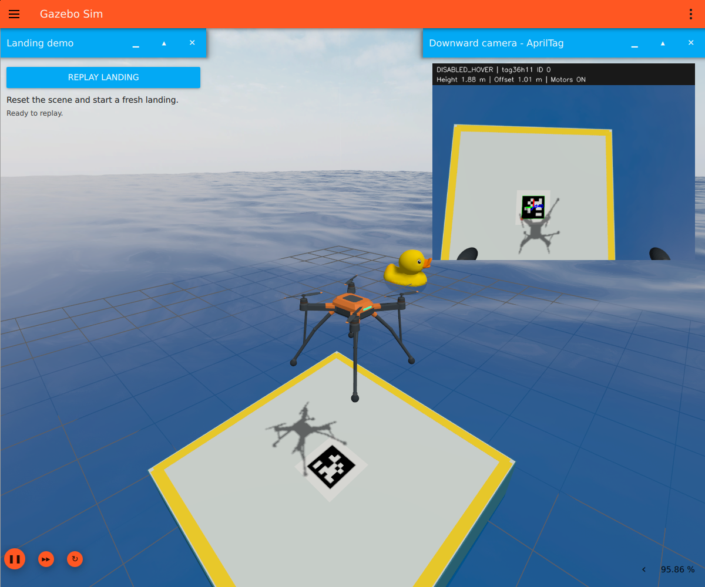
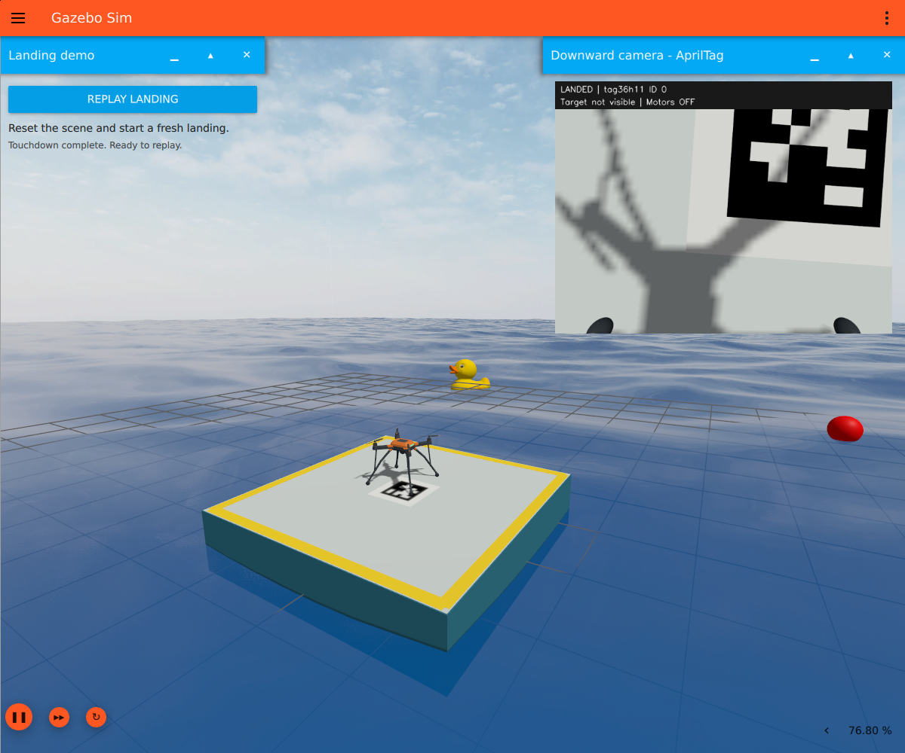
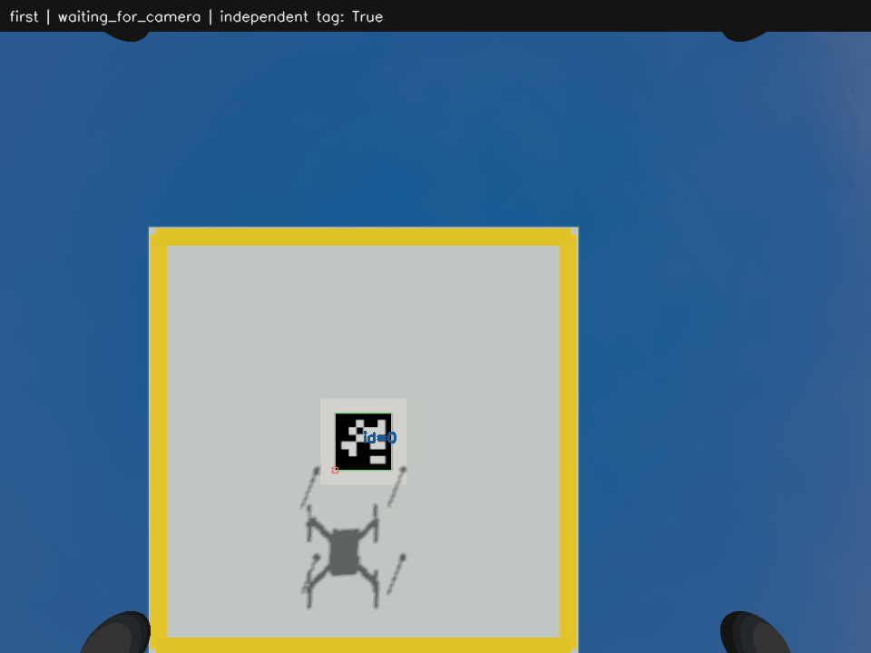

# Land a camera-equipped drone on the floating station

The landing scene adds a moored floating station, a replaceable AprilTag on its
deck, and a small four-rotor drone with a downward camera. The drone detects the
selected tag in the rendered images, centers over it, and descends until its
landing feet contact the station.

The updated drone has a connected canopy and frame, supported motors and
propellers, braced landing struts, contact feet and a mounted camera. All visible
parts use original Collada meshes. The physics, motor locations, foot collisions
and camera calibration remain unchanged.


*Actual Gazebo window recording: a landed drone resets to its airborne starting
pose and completes another landing. The upper-left replay control shows reset
progress; the upper-right panel shows the actual downward camera, tag outline,
guidance state and motor status.*

**Verified on the RTX 3060, 24 October 2026:** the replay began by clicking the
actual **Replay landing** button in the running Gazebo window. The subsequent
flight passed all 16 independent landing criteria: 0.274 m from the station
center, 1,095 physical foot/station contact messages, motors off and 2.0
simulated seconds of settled support.
[Replay landing report](verification/landing-visual-update/cycle-1/landing-report.json).

The GIF preserves 38.47 seconds of recorded timing from actual Gazebo window
captures at 1200 × 1000. It includes the landed starting scene, reset and
arming, the new flight and final touchdown. No frames were generated or
interpolated. [Capture record](verification/landing-visual-update/replay-landing.json)
and [replay summary](verification/landing-visual-update/replay-summary.json).



*The motor supports overlap the frame, each landing strut joins the body and
its contact foot, and the propeller hubs sit above the motor bells. The camera's
central downward view remains clear.*

The meshes are generated locally with explicit surface normals; no external
vehicle asset is required. See [model dimensions and regeneration instructions](ros/ocean_sim/models/landing_drone/MODEL_NOTES.md),
[mesh review](verification/landing-visual-update/mesh-review.json), and
[camera-clearance review](verification/landing-visual-update/clearance-review.json).

Earlier visual revisions passed physical landing checks with both `tag36h11`
ID 0 and `tag25h9` ID 7. Those reports and the previous single-flight recording
remain linked in [VALIDATION.md](VALIDATION.md).

## Start the demo

Complete [SETUP.md](SETUP.md) first. Keep Docker Desktop running and use an
**Ubuntu WSL2 terminal**, in the project directory containing `Dockerfile` and
`scripts/`. Rebuild an older image once to include the live camera, replay
button, connected drone meshes and wave-renderer reset support:

```bash
bash scripts/run-wsl.sh build
bash scripts/run-wsl.sh check
bash scripts/run-wsl.sh landing
bash scripts/run-wsl.sh logs
```

The landing action recreates the simulation container and opens the live
**Downward camera - AprilTag** panel in the upper right of Gazebo. Watch the
tag outline and pose axes as the state changes from alignment to descent,
flare, touchdown and `LANDED`. `Motors OFF` confirms the controller has completed
its contact check. The camera preview is 640 × 480 at up to 5 Hz; detection uses
the full 960 × 720 camera stream, nominally 20 Hz during flight. After motors
switch off, detection and preview run at up to 2 Hz to keep contact and replay
controls responsive. Resize the panel if needed.

Gazebo starts paused;
the bootstrap connects the controller command path before allowing physics to
advance. The default scene places the drone at `(0.8, -0.5, 3.0)` metres and
the station at `(0, 0, 0.15)` metres. The tag should begin within the camera's
view. This demo starts near a known landing area; it does not perform a global
search for a station outside the camera view.

Expect the controller to wait for the camera, align with the tag, descend, flare
near the deck, and confirm touchdown. It disables the motors after approximately
0.30 seconds of sustained landing-foot/station contact. Missing or stale tag
observations command a hover and pause the descent. Hover is velocity control;
it is not a GPS position hold.

`Ctrl+C` while following logs leaves the simulation running. To stop it:

```bash
bash scripts/run-wsl.sh stop
```

To launch **only ocean waves and floating objects** (the duck and buoy), with
**no drone, landing station or camera panel**, run this in the Ubuntu project
directory. It also replaces a running landing scene:

```bash
bash scripts/run-wsl.sh start
```

## Replay the landing in Gazebo

Click **Replay landing** in the **Landing demo** card at the upper left of the
Gazebo window. Use it during a flight, while paused, or after touchdown. The
button is temporarily disabled while the world resets and the motors arm;
the drone then locates the tag and lands again automatically.

Replay returns simulation time to zero and restores **all models** to their
configured starting poses, including the station, drone, duck and buoy. It
keeps the selected tag, the current camera view, the downward-camera panel and
the same Docker container. It starts automatic landing even if the scene was
originally launched with `AUTOLAND=false`.
Live wind changes return to the wave settings configured in the world file.



The current recording used the actual GUI button and confirmed one world-clock
reset. The same Docker container and Gazebo/controller processes remained
running. [Current replay verification](verification/landing-visual-update/replay-summary.json).

Earlier replay verification on the RTX 3060 passed after touchdown, during
flight and while paused. Three completed flights confirmed real contact,
motors off and two simulated seconds of settled support. Gazebo and the
container kept the same process identities throughout.
[Earlier replay verification](verification/landing-replay/replay-summary.json).

After upgrading, run `build` and `landing` once as shown above. Further replays
use the button without restarting Gazebo or Docker. Run the `landing` command
again when changing the tag or packaged scene configuration.

The equivalent command inside the ROS shell is:

```bash
ros2 topic pub --once /landing/replay std_msgs/msg/Bool '{data: true}'
```

`/landing/replay_status` reports progress. The JSON on `/landing/status`
includes `replay_count`, `replay_phase` and `replay_error`. Replay rewinds
`/clock`, so finish a recording before beginning another run.

To repeat the automated multi-replay check, start a fresh hover scene in Ubuntu:

```bash
AUTOLAND=false bash scripts/run-wsl.sh landing
bash scripts/run-wsl.sh exec
python3 /opt/ocean/container/replay_probe.py
```

The check sends native Gazebo requests, verifies a burst causes only one reset,
interrupts a flight, tests paused replay and independently verifies three
physical landings. Reports persist in `recordings/replay-check-<timestamp>/`.

## Change the AprilTag

The default is `tag36h11`, ID `0`, with a **0.40 m outer black-border size**.
A 0.10 m white margin on each side makes the complete board 0.60 m square.
The pose estimator uses the black-border dimension, excluding the white margin.

Select another ID, or another supported family and ID, when starting the scene:

```bash
TAG_ID=7 bash scripts/run-wsl.sh landing
```

```bash
TAG_FAMILY=tag25h9 TAG_ID=2 TAG_SIZE=0.4 bash scripts/run-wsl.sh landing
```

Supported families are `tag16h5`, `tag25h9` and `tag36h11`. The scene generator
validates the ID against the chosen dictionary, creates the texture, and checks
that the generated bitmap decodes. Each landing launch generates a matching
texture and detector configuration in a fresh runtime directory. These launch
overrides do not require an image rebuild. Re-run the landing action to change
the physical marker and its detector together; changing only the detector's ROS
parameters leaves the board image unchanged.

Keep `TAG_SIZE=0.4` for the validated landing geometry. A larger physical marker
may leave the camera view near touchdown and require a wider field of view or
more camera-to-feet clearance. The estimator's size must match the black border.

The detector uses OpenCV's AprilTag dictionaries and quad/corner refinement,
camera calibration, planar pose estimation and nonlinear pose refinement. See the
[OpenCV marker-detection API](https://docs.opencv.org/4.5.4/d9/d6a/group__aruco.html)
for the dictionary and detection interfaces.

## Begin in hover, then allow landing

Start with descent disabled:

```bash
AUTOLAND=false bash scripts/run-wsl.sh landing
```

In a second Ubuntu terminal, open the running container's ROS shell:

```bash
bash scripts/run-wsl.sh exec
ros2 topic echo /landing/status --once
ros2 param set /vision_landing enabled true
```

Setting `enabled` to `false` again pauses automatic guidance and requests hover.
It does not restart a completed, motors-off landing. Click **Replay landing**
for a fresh flight, or use the replay topic command above.

## Inspect the camera and guidance

The annotated camera is displayed automatically inside Gazebo. The detector
publishes `/landing/debug_image` as RGB, and the landing bridge sends it back
to Gazebo's native `ImageDisplay` plugin. This is the same image that the
detector processed, with its measured tag corners and pose drawn on top.
The preview is resized after pose estimation; it does not change calibration.
If you close the panel, re-run the landing action to restore the default layout.
If camera messages stop, the panel retains its last frame; inspect the live
`/landing/status` topic for current controller state. Target loss pauses descent.

Run these inside the ROS shell opened with `bash scripts/run-wsl.sh exec`.
Use `Ctrl+C` to stop a continuous topic display before running the next command.

```bash
ros2 topic echo /landing/state
ros2 topic echo /landing/status --once
ros2 topic echo /landing/replay_status --once
ros2 topic echo /landing/tag_pose --once
ros2 topic hz /drone/camera/image_raw
ros2 topic info /landing/debug_image --verbose
```

| Topic | Meaning |
| --- | --- |
| `/drone/camera/image_raw` | Actual Gazebo downward-camera images, nominally 960 × 720 at 20 Hz. |
| `/drone/camera/camera_info` | Intrinsic calibration used for metric tag pose estimation. |
| `/landing/debug_image` | 640 × 480 RGB annotated preview, bridged into the Gazebo GUI, up to 5 Hz by default. |
| `/landing/tag_pose` | Detected tag pose in optical camera coordinates, in metres. |
| `/landing/state` | Current state, such as `aligning`, `descending`, `flaring` or `landed`. |
| `/landing/status` | JSON including selected tag, detection count, lateral error, camera height, contact, motor state and replay progress/error. |
| `/landing/replay` | Publish `std_msgs/msg/Bool` with `data: true` to reset the world and start another landing. |
| `/landing/replay_status` | Replay progress as `std_msgs/msg/String`, also displayed by the GUI card. |
| `/drone/contacts` | Physics contact messages from the landing feet. |

To save full-resolution camera frames from the current flight, run this in the
same ROS shell, preferably
before enabling landing:

```bash
python3 /opt/ocean/container/landing_probe.py \
  --output "/recordings/manual-landing-$(date -u +%Y%m%dT%H%M%SZ)" \
  --wall-timeout 180
```

The probe observes the flight and writes PNGs; it sends no flight commands. It
waits for a verified landing, so enable landing from another ROS shell if the
scene is in hover. The image's `/recordings` directory is mounted from your
project's `recordings/` folder. Open that folder from Windows to inspect the
raw `*-camera.png` and detected-tag `*-annotated.png` files. Near-deck images
are saved when that part of the flight is reached, and the final image is saved
on success or failure.



*These three snapshots come from the earlier baseline verification. The
side-view animation at the top is a continuous sequence from the live GUI.*

## Run the automated landing check

From the Ubuntu project directory, outside the container shell:

```bash
bash scripts/run-wsl.sh landing-test
```

This launches a separate default landing scene with an isolated Gazebo partition
and ROS domain. It renders the real camera through Ogre2 while running without
the Gazebo GUI. It leaves an existing GUI scene independent of the check.

Evidence persists under `recordings/landing-check-<UTC timestamp>-<process ID>/`:

- `simulation.log` and `probe.log` explain startup and flight progress.
- `first-`, `near-` and `final-camera.png` show received camera images, where available.
- Matching `*-annotated.png` images show an independent tag decode.
- `landing-report.json` records each pass/fail condition and measured results.
- `relative-pose-samples.json` records the evaluated drone/station displacement.

The check requires camera images and calibration, independently decoded tags,
vision pose messages, physical foot/deck contact, motors off, a centered landing
that remains settled, and a station that stays near its horizontal anchor while
heaving with the waves. Ground-truth station and drone poses are used by this
evaluation probe only; the visual landing guidance does not subscribe to them.
Consult the JSON report after a failed check rather than treating `landed` alone
as proof of a stable physical landing.

## Configure the scene and controller

Persistent defaults live in [config/landing.yaml](ros/ocean_sim/config/landing.yaml).
The `scene` section controls the tag family, ID, black-border size, white margin,
and station/drone spawn coordinates. The `controller` section controls guidance:

| Setting | Purpose |
| --- | --- |
| `horizontal_gain`, `horizontal_limit` | Centering response and maximum horizontal speed, in m/s. |
| `alignment_tolerance`, `alignment_hold` | Lateral error limit in metres and time to remain aligned before descending. |
| `descend_rate`, `flare_rate` | Descent speeds in m/s, including the slower near-deck approach. |
| `camera_clearance` | Camera-to-deck distance with the feet touching; default 0.35 m for this geometry. |
| `target_timeout` | Maximum age of a tag observation before requesting hover. |
| `contact_hold` | Required contact interval before disabling the motors. |

After editing packaged source, configuration or models, rebuild and recreate:

```bash
bash scripts/run-wsl.sh build
bash scripts/run-wsl.sh landing
```

The optional development overlay mounts launch/config/world/model data directly:

```bash
OCEAN_DEV=1 bash scripts/run-wsl.sh landing
```

Continue using `OCEAN_DEV=1` on subsequent runner commands. Data edits then need
a new landing launch to regenerate the scene. Python controller code and the
compiled C++ mooring plugin still require rebuilding the image.

## Physical model and coordinate frames

The station is a dynamic 3 × 3 × 0.7 m hull with a mass of 1800 kg. Wave
hydrodynamics supplies buoyancy and motion. A bounded horizontal spring and
damper keeps it near its initial x/y position; a yaw spring resists rotation.
The supplied horizontal stiffness is 20,000 N/m with 12,000 Ns/m damping.
It remains free to heave, roll and pitch, so the landing surface moves. Mooring
settings are in the
[station model](ros/ocean_sim/models/floating_station/model.sdf); the
[mooring system notes](ros/ocean_station_systems/README.md) explain their units
and tuning.

The drone uses body **FLU** coordinates: x forward, y left, z up. OpenCV optical
coordinates are x right, y down, z forward. With this downward camera, an optical
vector `(x, y, z)` maps to body `(-y, -x, -z)`, followed by the camera's fixed
position offset. The tag-pose topic uses optical coordinates; the velocity
command uses body coordinates. This demo does not provide a complete TF tree.

The outer loop estimates relative position from the real rendered tag image.
Gazebo's multicopter velocity/attitude inner loop uses simulation orientation
and velocities and drives four motor models. That built-in controller explicitly
uses simulation ground truth internally, as described in the
[Gazebo multicopter controller API](https://gazebosim.org/api/sim/8/classgz_1_1sim_1_1systems_1_1MulticopterVelocityControl.html).
The scene is a visual landing simulation using that inner loop; it does not
implement PX4/ArduPilot or an onboard state estimator.

## Troubleshoot a flight

- **Replay button missing after an upgrade:** rebuild the updated image, then
  run `bash scripts/run-wsl.sh landing` once. Later replays use the button.
- **Replay reports an error:** inspect `/landing/replay_status`, the
  `replay_error` field in `/landing/status` and the container logs before retrying.
- **No camera frames:** inspect `simulation.log` for Sensors, Ogre2 or image-bridge
  errors, then repeat `bash scripts/run-wsl.sh check` for the graphics path.
- **Blank camera panel:** allow the first rendered frames to arrive, then check
  `ros2 topic info /landing/debug_image --verbose`. Keep its `ROS_TO_GZ` bridge
  and `rgb8` encoding: Harmonic's image viewer does not display BGR images.
  Rebuild and recreate the container after upgrading the packaged Python code.
- **Camera works but no tag pose:** inspect a raw camera PNG. Check the selected
  family/ID, marker size and visibility; start with the default spawn positions.
- **Tag lost near the deck:** inspect the annotated frames for cropping,
  occlusion, rocking or excessive lateral error. Hover is the expected response
  to a lost target; recenter or restart from the default scene before tuning.
- **Touchdown without completion:** inspect `/drone/contacts` and the report.
  The controller needs actual landing-foot/station contact; estimated altitude
  alone does not authorize motor shutdown.
  The reset-aware contact plugin publishes four Harmonic-compatible scoped
  foot-contact topics. Keep their
  fan-in mappings in `config/landing_bridge.yaml`; the outer sensor `<topic>`
  element does not set the Contact system's publication topic.
- **Station drifts or rocks excessively after changes:** restore the default
  hull, mooring and wave settings, then adjust one parameter at a time. A larger
  horizontal spring does not freeze heave or tilt.
