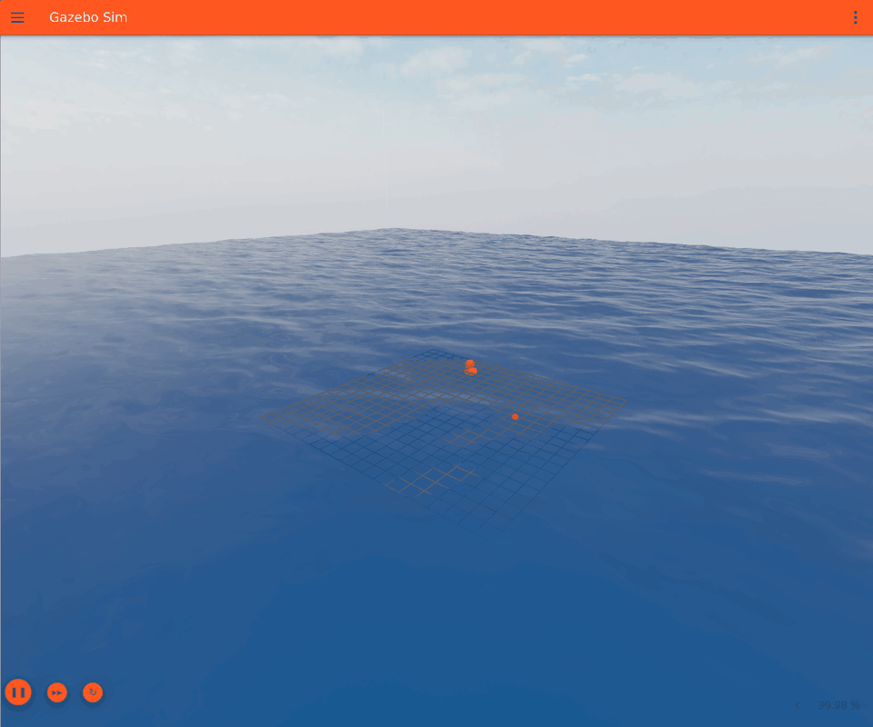
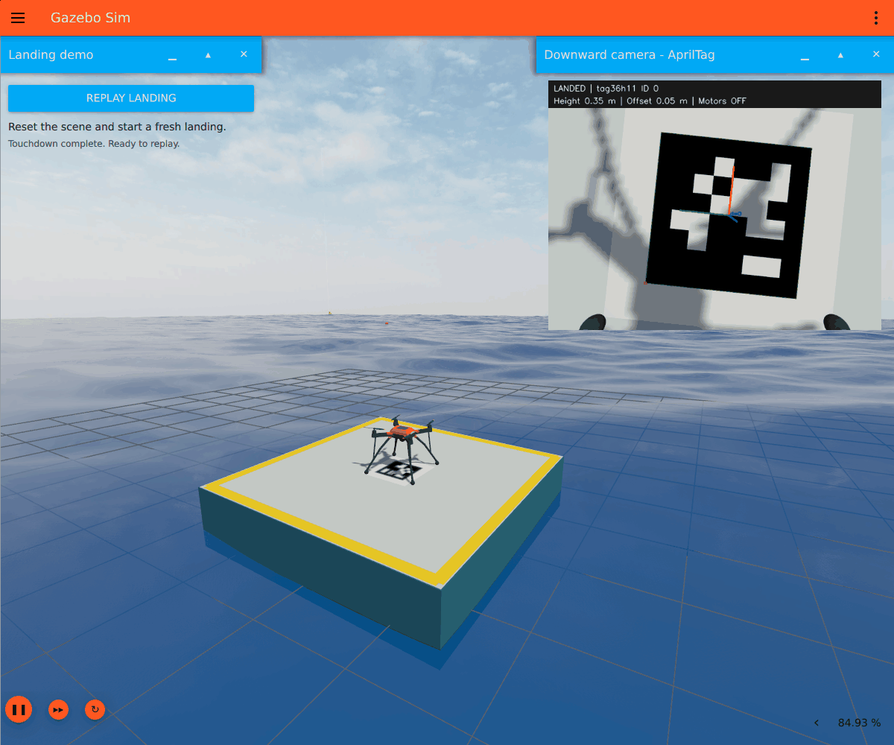

# Ocean waves in Docker: ROS 2 Humble + Gazebo + RTX 3060 on Windows

> **Project highlight:** Animated ocean waves and floating objects in Gazebo, with ROS 2 Humble running in Docker on Windows.
>
> **Verified on RTX 3060 — 23 October 2026:** WSLg/D3D12 GPU rendering, OpenGL 4.2, and passing ROS clock and buoy-motion checks. [Validation details](VALIDATION.md)
>
> **Landing demo:** A connected mesh drone locates the station with its downward camera and lands. Click **Replay landing** in Gazebo to repeat the flight. [Watch the reset and landing GIF](LANDING.md)

This project builds `ros-humble-ocean:harmonic`, an Ubuntu 22.04 Linux image with ROS 2 Humble, Gazebo Harmonic, ASV Wave Sim, and a ROS bridge. The default scene contains animated FFT ocean waves and floating objects with buoyancy and hydrodynamic forces. The GUI opens as a Windows window through WSLg.

## Final output



*Actual Gazebo GUI capture from the verified RTX 3060 run, showing the ocean surface and floating objects moving.*

[View the full-resolution screenshot](verification/gazebo-ocean.png) · [Set up on a new device](SETUP.md)

**Updated status, 23 October 2026:** WSL2 and Docker work, the patched image is built, and the Gazebo GUI runs with visibly animated waves. Both the standalone GPU check and the GUI's Ogre2 log confirm `D3D12 (NVIDIA GeForce RTX 3060)`, OpenGL 4.2 and Mesa 23.2.1. The rebuilt image passed the headless smoke test: clock advanced 8.00 seconds and buoy height varied by 0.526 m. A separate probe in the actual GUI simulation passed with 8.00 seconds and 0.557 m. See [VALIDATION.md](VALIDATION.md) and the [actual GUI recording](verification/gazebo-ocean.gif). Your RTX 3060 has 12 GB of VRAM, and the computer has approximately 16 GB of system RAM.

For installation from scratch on another computer, follow [SETUP.md](SETUP.md). Use this README for setup reference and image updates. [WORKFLOW.md](WORKFLOW.md) covers the daily simulation, ROS development and experiment-recording workflow. [VALIDATION.md](VALIDATION.md) records measured runtime results and remaining limits.

## Choose a scene

Run these commands in **Ubuntu**, from the project directory, with Docker Desktop running:

| Scene | Command |
| --- | --- |
| Ocean waves, duck and buoy, without a drone or landing station | `bash scripts/run-wsl.sh start` |
| Ocean, floating station and drone, with live AprilTag camera view | `bash scripts/run-wsl.sh landing` |

Each command recreates `ocean-sim` and resets the world. To return from the
landing demo to the ocean and floating objects alone:

```bash
bash scripts/run-wsl.sh start
```

## Floating station and AprilTag-guided drone landing



*Actual Gazebo window recording: the landed drone returns to its starting pose
during replay, then locates the tag and lands again. The replay control and
live downward-camera panel remain visible. The recorded replay passed all 16
independent landing checks, with 1,095 physical foot/station contacts, motors
off and two simulated seconds of settled support.*

The drone now uses connected meshes for its canopy, frame, motor supports,
propellers, braced landing legs, feet and camera. The visual revision preserves
the original physical model and camera calibration.
[Inspect the model close-up](verification/landing-visual-update/connected-drone.png)
and [read the model notes](ros/ocean_sim/models/landing_drone/MODEL_NOTES.md).

Rebuild the updated image once, then run from Ubuntu in your project directory:

```bash
bash scripts/run-wsl.sh build
bash scripts/run-wsl.sh landing
```

Gazebo opens a **Downward camera - AprilTag** panel alongside the 3D view.
It shows the live camera image with detected tag corners and pose axes, the
tag family and ID, the landing state, height, horizontal offset and motor state.
Watch the drone center over the marker, descend and stop its motors after
confirmed deck contact. The annotated panel displays 640×480 images at up to
5 Hz; the detector uses the original 960×720 camera stream, configured at 20 Hz.

Click **Replay landing** in the upper-left **Landing demo** card to repeat the
flight. It resets world time and all model poses, then starts landing again;
the current view, camera panel and Docker container stay open. The button
works during flight, while paused and after touchdown, and is temporarily
disabled during reset and arming. [Replay details](LANDING.md#replay-the-landing-in-gazebo).

To change the tag and launch a fresh flight:

```bash
TAG_ID=7 bash scripts/run-wsl.sh landing
```

The default is a 0.40 m `tag36h11` marker on a 3 m station, viewed by a downward
960×720 camera. The generator changes both the texture and detector settings.
The outer landing loop uses camera observations; Gazebo supplies the simulated
multicopter attitude/velocity inner loop. This demo begins near a visible
station. [LANDING.md](LANDING.md) covers tag families, camera topics, hover mode,
configuration, a side-view landing GIF and independent landing verification.

## 1. Prepare Windows once

Docker Desktop, WSL2 and Ubuntu integration are now working. Keep the steps in this section as setup reference; continue with the existing installation rather than reinstalling Ubuntu. A newly opened PowerShell terminal should pick up Docker's updated command path. The supplied `scripts/check-windows.ps1` can also find Docker at its per-user install location and report prerequisites without changing settings:

```powershell
powershell -NoProfile -ExecutionPolicy Bypass -File "C:\Users\aston\Documents\Codex\2026-10-11\i-x20\outputs\ocean-ros-humble\scripts\check-windows.ps1"
```

For a new machine without Ubuntu, open **PowerShell as administrator** and install Ubuntu on WSL2:

```powershell
wsl --install -d Ubuntu-22.04
```

Restart Windows if prompted. Open Ubuntu from Start and finish creating your Linux username and password. Then run in PowerShell:

```powershell
wsl --update
wsl --list --verbose
```

Ubuntu must show `VERSION 2`. If it shows 1, run `wsl --set-version Ubuntu-22.04 2`. Microsoft documents the installation and first-launch steps in [Install WSL](https://learn.microsoft.com/en-us/windows/wsl/install).

Start your installed Docker Desktop. Select Linux containers and configure:

- **Settings > General > Use the WSL 2 based engine**.
- **Settings > Resources > WSL Integration > Ubuntu-22.04** enabled.

Apply the settings and reopen Ubuntu. If the WSL2-engine option is hidden, it can already be enabled by default. Docker may install its own internal WSL environment; the user-facing Ubuntu distribution is still needed for this project's WSLg launch workflow. Follow [Docker's WSL2 setup guide](https://docs.docker.com/desktop/features/wsl/). Install ROS and Gazebo through this Docker image; Ubuntu only needs to provide WSLg and the Docker client integration.

Keep the Windows NVIDIA driver current. Install drivers on Windows; do not install a Linux NVIDIA display driver inside WSL or the container. See [NVIDIA's WSL guide](https://docs.nvidia.com/cuda/wsl-user-guide/). No separate Windows X server is needed.

### Resource settings for your 16 GB computer

Start with two compiler jobs and the existing 128×128 FFT grid. WSL's default memory allowance is normally sufficient to begin. If the compiler runs out of memory, first try `BUILD_JOBS=1`. For deliberate limits, [config/wslconfig.16gb.example](config/wslconfig.16gb.example) suggests an 8 GB WSL memory ceiling, four logical processors and 4 GB swap, keeping capacity available for Windows.

To apply those optional limits, merge the sample settings into `C:\Users\aston\.wslconfig`. Save your work and quit Docker Desktop, then run `wsl --shutdown` in PowerShell and reopen Docker Desktop and Ubuntu. This restart affects all WSL distributions. `autoMemoryReclaim=gradual` lets Windows reclaim unused WSL memory after builds. These settings are documented by [Microsoft](https://learn.microsoft.com/en-us/windows/wsl/wsl-config); no host configuration is changed by this project.

## 2. Build in the Ubuntu WSL terminal

The image has already been built on this machine. The tested active project is `/mnt/c/Users/aston/Documents/Codex/2026-10-11/i-x20/outputs/ocean-ros-humble`; use that directory for the current environment. For a fresh checkout or an optional move to the faster Linux filesystem, open **Ubuntu**, then copy the project:

```bash
mkdir -p ~/simulations
cp -a /mnt/c/Users/aston/Documents/Codex/2026-10-11/i-x20/outputs/ocean-ros-humble ~/simulations/
cd ~/simulations/ocean-ros-humble
bash scripts/run-wsl.sh doctor
bash scripts/run-wsl.sh build
```

The first build needs internet access to Docker Hub, the Ubuntu/ROS/OSRF package servers and GitHub. It compiles the wave plugins and can take several minutes. Two compiler jobs are the default to limit memory use; use `BUILD_JOBS=1 bash scripts/run-wsl.sh build` if a compiler is killed for insufficient memory. Allow several GB of disk space for the image and build cache.

ASV Wave Sim is pinned to commit `ca8629df4e191235753dfae92ef725d30b923364`. Ubuntu/ROS packages and the base image receive updates when rebuilt; installed versions are recorded in `/opt/ocean/build-info.txt`. The source remains in the image for development and model resources.

The build applies [asv-wave-visual-dedup.patch](patches/asv-wave-visual-dedup.patch) to that pinned source. Duplicate GUI initialization previously caused a second WavesVisual instance to resize textures already resident in Ogre2, triggering an assertion. The patch permits one owner for each visual entity within its Entity Component Manager, preventing the duplicate initialization. It keeps the `GzSceneManager` plugin and the existing Ogre2 ocean-rendering path. See [patch notes](patches/README.md) and the related [Gazebo issue #1647](https://github.com/gazebosim/gz-sim/issues/1647), which documents repeated visual-plugin initialization.

The following [asv-wave-reset.patch](patches/asv-wave-reset.patch) preserves
the wave visual's GPU resources through Gazebo's reset interface. This lets
the replay button rewind the world without recreating resident ocean textures.
Both compiled patches require rebuilding the image when upgrading.

If you have an older image that crashes with the Ogre2 texture assertion, update the project files, then run from your active Ubuntu project directory:

```bash
bash scripts/run-wsl.sh build
bash scripts/run-wsl.sh check
bash scripts/run-wsl.sh smoke
bash scripts/run-wsl.sh restart
```

The compiled plugin patch requires an image rebuild; the development overlay alone cannot apply it. Keep `GzSceneManager` in the world so the GUI receives scene updates.

`doctor` checks the Linux Docker engine, WSLg display sockets, DirectX device and driver libraries before the build. `check`, after the build, verifies actual accelerated OpenGL. Run commands in Ubuntu without `sudo`; Docker Desktop integration supplies the engine connection.

## 3. Verify the GPU and simulation, then start

Run these commands from the same Ubuntu project directory:

```bash
bash scripts/run-wsl.sh check
bash scripts/run-wsl.sh smoke
bash scripts/run-wsl.sh start
bash scripts/run-wsl.sh status
```

The GPU check must report all of these:

```text
Accelerated: yes
OpenGL renderer string: D3D12 (NVIDIA GeForce RTX 3060 ...)
OpenGL core profile version string: 4.2 or newer
GPU check passed: ...
```

`D3D12 (NVIDIA ...)` is the expected accelerated OpenGL renderer on Windows WSLg. The OpenGL vendor may be Microsoft; this is normal. The checker rejects CPU rendering (`llvmpipe` or `softpipe`), a different adapter, and an insufficient OpenGL version. Startup repeats the check before launching the GUI.

These checks cover separate parts of the environment:

| Check | What it verifies |
| --- | --- |
| `check` | Accelerated OpenGL on the intended RTX 3060 through WSLg. |
| `smoke` | Headless world validation, advancing ROS `/clock`, and vertical buoy motion on `/ocean/buoy/pose`. |
| `start` plus inspection of the GUI | The ocean material renders, waves visibly animate, and floating objects appear in the Ogre2 scene. |

When the window opens, verify that the ocean surface and floating objects move. Scroll to zoom and drag to adjust the view. The GUI's rendering log is `/root/.gz/rendering/ogre2.log` inside `ocean-sim`; the verified run records the NVIDIA D3D12 renderer there.

Accept the baseline when the GUI opens, waves and buoy move, `/clock` advances, and `status` shows the simulation running. Keep the initial working sea settings before adding a vessel or controller. `start` recreates the simulation from its initial state; use it once at the beginning of a session. `restart` recreates it deliberately after changes, and resets the world too.

Follow startup logs and stop the environment with:

```bash
bash scripts/run-wsl.sh logs
bash scripts/run-wsl.sh stop
```

## 4. Use ROS inside the running container

In a second Ubuntu terminal:

```bash
bash scripts/run-wsl.sh exec
ros2 topic list
ros2 topic echo /clock --once
ros2 topic echo /ocean/buoy/pose --once
ros2 topic echo /ocean/poses --once
```

Use the entrypoint when opening a shell so ROS and Gazebo resource paths are sourced. `/ocean/buoy/pose` carries the spherical buoy's `geometry_msgs/msg/PoseStamped` through a dedicated Gazebo PosePublisher; inspect `pose.position.z` for vertical motion. `/ocean/poses` retains the raw `tf2_msgs/msg/TFMessage` bridge from Gazebo's SceneBroadcaster stream for compatibility. Its transforms have empty `child_frame_id` in this tested configuration, so it cannot identify entities by name and is not a robot TF tree. Use the dedicated buoy topic for buoy measurements. For your own nodes, set `use_sim_time:=true`. The default ROS domain is 30; the isolated smoke test uses 31.

The project can also open a new development container with `bash scripts/run-wsl.sh shell`. Additional containers have their own ROS network unless you arrange shared networking; the simplest starting point is to run your nodes in `ocean-sim`.

Your project's `workspace/` directory is mounted at `/workspace` for persistent ROS packages and build outputs. `recordings/` is mounted at `/recordings` for persistent experiment data. Both survive `stop`, which removes the container. The image includes ROS bag recording tools; [WORKFLOW.md](WORKFLOW.md) gives recording, replay and controller-build commands.

## 5. Adjust the sea

The default surface covers approximately 300 m by 300 m, using a 100 m tile repeated 3 by 3, with a 128 by 128 FFT grid. Wave rendering and buoyancy use matching wave settings. The default wind is 5 m/s at 135 degrees.

To change waves while Gazebo is running, use the included `set-waves` command from the sourced container shell. Run `set-waves --help` for its arguments. Its controls update both the physical wave field and the visible surface through Gazebo transport.

For persistent defaults, edit both `<wave>` blocks in `ros/ocean_sim/models/ocean_surface/model.sdf`, then build and restart. For faster world/model/config/launch editing, use the development overlay:

```bash
export OCEAN_DEV=1
bash scripts/run-wsl.sh start
# Edit ros/ocean_sim files in your Ubuntu project, then:
bash scripts/run-wsl.sh restart
```

The overlay mounts those simulation files read-only into the container; changes take effect on the next launch. Changes to dependencies, Dockerfile, ASV plugins or container scripts still require an image rebuild. Keep the physics and visual settings consistent. ASV Wave Sim supports FFT, sinusoidal and trochoidal wave algorithms; the included model uses FFT. This is a surface and rigid-body marine simulation, rather than a full fluid CFD solver.

## Why this GPU configuration works

The container receives `/dev/dxg`, the WSL driver libraries at `/usr/lib/wsl`, and the WSLg display sockets. Ubuntu's Mesa D3D12 driver translates OpenGL to the Windows GPU. `MESA_D3D12_DEFAULT_ADAPTER_NAME=NVIDIA` selects the NVIDIA adapter, and `GPU_EXPECT=3060` verifies the intended card. This follows [Microsoft's WSLg container guidance](https://github.com/microsoft/wslg/blob/main/samples/container/Containers.md) and [GPU selection guidance](https://github.com/microsoft/wslg/wiki/GPU-selection-in-WSLg).

Docker's GPU reservation also exposes NVIDIA compute access. The Windows graphics path uses Mesa, so the container requests NVIDIA `compute,utility` capabilities; Linux NVIDIA OpenGL libraries are not used for this WSLg path. A successful `nvidia-smi` check alone proves compute visibility and does not prove Gazebo graphics acceleration. Docker's [Windows GPU documentation](https://docs.docker.com/desktop/features/gpu/) describes its WSL2 requirement.

The RTX 3060 accelerates Gazebo rendering and rendering-based sensors. FFT waves, hydrodynamics and rigid-body dynamics run on the CPU in this implementation.

Humble's default Gazebo pairing is Fortress. This image intentionally uses Harmonic because the current wave simulator supports it and supplies Ogre2 ocean rendering. It installs OSRF's explicit `ros-humble-ros-gzharmonic` packages. Avoid adding the Fortress `ros-humble-ros-gz*` packages to this image because they conflict. See [Gazebo's Humble/Harmonic installation instructions](https://gazebosim.org/docs/harmonic/ros_installation/#gazebo-harmonic-with-ros-2-humble).

## Troubleshooting

| Symptom | Action |
| --- | --- |
| `docker` unavailable in Ubuntu | Start Docker Desktop and enable WSL Integration for Ubuntu-22.04. |
| `docker` unavailable in the original PowerShell window | Open a new terminal to refresh PATH, or run the supplied Windows prerequisite checker. |
| Docker client works but the engine is unreachable | Finish WSL2 setup, start Docker Desktop, and wait until its engine is running. |
| `/dev/dxg` missing | Confirm WSL2, run `wsl --update` in PowerShell, and update the Windows NVIDIA driver. |
| Display cannot open | Use the Ubuntu WSL terminal. Confirm `echo "$DISPLAY"` and `/mnt/wslg` exist. After saving WSL work, `wsl --shutdown`, restart Docker Desktop and reopen Ubuntu. |
| Renderer is `llvmpipe` | Check the driver, WSL mounts and D3D12 library; rebuild to install current Jammy Mesa. Do not force a fake OpenGL version. |
| Wrong GPU selected | Set `MESA_D3D12_DEFAULT_ADAPTER_NAME='NVIDIA GeForce RTX 3060'` before invoking the runner. |
| OpenGL below 4.2 | Update Windows NVIDIA driver, WSL and rebuild the image. The checker intentionally refuses an incompatible renderer. |
| Plugin or mesh fails to load | Inspect logs; the entrypoint must source both workspaces and expose the ASV resource and rendering plugin paths. |
| Standalone `gz sdf -k` reports an unresolved `model://` URI or URI callback error | Use the updated smoke script. The standalone SDFormat validator needs `SDF_PATH` for model lookup; Gazebo Sim uses `GZ_SIM_RESOURCE_PATH`. The fix sets `SDF_PATH` only for the validation command. |
| `/ocean/poses` has empty frame names | This is the observed SceneBroadcaster bridge output. Use `/ocean/buoy/pose` for the buoy rather than filtering the raw stream by name. |
| Waves look still | Confirm simulation is playing, `/clock` advances, and the WavesVisual plugin loaded in the logs. |
| Gazebo GUI exits with an Ogre2 texture assertion | Update the project and rebuild with both patches in `patches/`, then launch `start` or `landing`. The patches protect initial visual loading and world reset. Keep `GzSceneManager`; `check` and headless `smoke` alone do not test ocean-material rendering. |
| Replay button is missing | Rebuild the updated image, then run `bash scripts/run-wsl.sh landing` once. Subsequent replays use the GUI button. |
| Build runs out of memory | Use `BUILD_JOBS=1`; increase WSL memory if your available system RAM permits. |

To run the standalone validator manually in a sourced container shell:

```bash
share=$(ros2 pkg prefix --share ocean_sim)
SDF_PATH="${GZ_SIM_RESOURCE_PATH:-}${SDF_PATH:+:${SDF_PATH}}" gz sdf -k "$share/worlds/ocean.sdf"
```

This command does not change the resource environment of later Gazebo launches. If you still see the original smoke error after updating the project, rebuild the image so it includes the updated validation script and buoy model.

## Files and upstream licenses

`Dockerfile` builds the image and applies the ASV compatibility patches in `patches/`; `compose.wsl.yaml` supplies Windows GPU/display connections and persistent folders; `compose.dev.yaml` adds editable simulation files; `scripts/run-wsl.sh` manages them. `ros/ocean_sim` contains the world, surface model, launch and bridge configuration. `container` contains startup and runtime checks. `scripts/check-windows.ps1` diagnoses the Windows prerequisites, and `WORKFLOW.md` covers daily use.

Wave plugins and included wave material assets come from [ASV Wave Sim](https://github.com/srmainwaring/asv_wave_sim), which is GPL-3.0. Upstream source and license files are retained in the image; copied asset license information is in `third_party/asv_wave_sim`. Preserve these notices when sharing the project or image.
